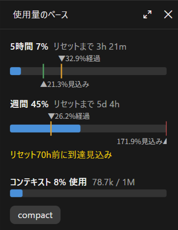

# usage-pace

[日本語](README.ja.md)

A Claude Code mod that shows your plan's usage limits (5-hour and weekly) as meters, with the elapsed time and a pace projection.



## What it shows
Three parts, each of which can be turned on or off.

**Usage pace (`pace`, in the pane)**
- The share used (whole percent) and the time left until the reset
- `▼xx.x% elapsed` above the meter: how much of the window's time has passed (where usage would be at an even pace)
- `▲xx.x% projected` below the meter: the share used at the reset if the current pace goes on (at the right end when over 100%)
- When the projection is over 100%: "Reaches 100% xxh before the reset" (xxm for the 5-hour window)
- Each label sits on whichever side of its marker has room

**Context (`context`, in the pane)**
- `Context 42% used  84.2k / 200k` and a meter
- Yellow from 50%, orange from 70%, red from 85%
- The `compact` button below makes the same summary as `/compact` (after the reply, if one is in progress)

**The line under the prompt (`line`)**
- `[S] 32% 2h55m e: 76.8% , [W] 34% 5d19h e: 200.9% (-84h) , [C] 42%`
- S is the 5-hour window, W the weekly one, C the context. `e` is the projection at the reset; the bracket says how many hours (minutes for the 5-hour window) before the reset the pace reaches 100%
- `/usage-pace line tiny` packs it: `[S]32%,2h55m,e:76.8%[W]34%,5d19h,e:200.9%(-84h)[C]42%` (without the "last reading" tag). `line on` brings back the full line

The figures update when a reply from Claude arrives: the mod uses what Claude Code already receives and makes no requests of its own. Only the elapsed share moves on its own, once a minute.

In a new chat, until its first reply, the mod shows the last usage any chat received, marked as the last reading. A window whose reset time has passed is left out. The context belongs to each chat, so it appears after the first reply.

## Language
Japanese and English. The mod follows Claude Code's `language` setting, or the system's language when that is not set; anything other than Japanese is shown in English.

## Usage
- `/usage-pace`: open or close the pane
- `/usage-pace <part> [on|off]`: show or hide a part; without on/off it flips
  - parts: `pace` (usage pace), `context` (context), `line` (the line under the prompt), `all`
  - `line` also takes `tiny` (the packed line)
  - e.g. `/usage-pace line off`, `/usage-pace all on`
- `/usage-pace status`: the current settings

The settings are shared by every chat and apply to the next chat you open. With both `pace` and `context` off, the pane does not open.

## Install
In Claude Code in a terminal:

```
/plugin install usage-pace --marketplace sand-jp/usage-pace
```

In the desktop app: + beside the prompt → Plugins → Add marketplace, enter `sand-jp/usage-pace` → Add plugin.

## License
0BSD. You are free to use, read, modify, improve and redistribute this, with no need to keep any notice.

## Use of AI
This mod was made with AI (Claude Code). Most of the code and text was written by the AI, then reviewed and adjusted by the author.
